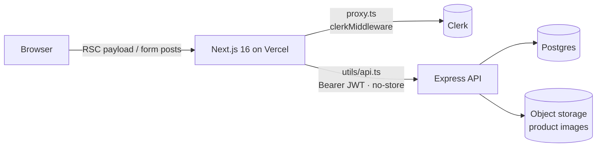

<div align="center">

# عَبَق · Perfume Store

**A production-grade, Arabic-first (RTL) e-commerce storefront for luxury fragrances.**

Next.js 16 App Router · React 19 Server Components · Server Actions · Clerk Auth · Express REST backend


</div>

---

## Overview

**عَبَق** is the storefront half of a two-tier commerce platform. The UI is a fully server-rendered
Next.js 16 application. Every byte of data comes from a separate **Express REST API**
(`backend-perfume-store`), and the browser never talks to that API directly.

Every request leaves the server through a single typed gateway (`utils/api.ts`) that attaches the user's
**Clerk session JWT** as a `Bearer` token. The backend verifies the token and enforces ownership
and roles. No secret or token ever reaches client-side JavaScript.

## Features

| Area | What it does |
| --- | --- |
| 🛍️ **Catalog** | Hero carousel, featured products, category browsing, debounced full-text search |
| ❤️ **Favorites** | Server-side toggle, persisted per user |
| 🛒 **Cart** | Quantity updates, line removal, totals recomputed on the backend from current prices |
| 💳 **Checkout** | Whole-cart or single-product “buy now”, redirect to the payment gateway, `/payment-result` callback |
| ⭐ **Reviews** | Star ratings and comments, with the author identity taken from Clerk on the server |
| 🧑‍💼 **Admin dashboard** | Product & category CRUD, image replacement, and all orders. Gated in the proxy *and* on the API |
| 🌍 **i18n / UX** | Native RTL layout, Arabic Clerk localization, dark mode, skeleton loading states, toasts |
| 🔗 **Sharing** | Social share buttons with canonical URLs |

## Architecture



```
app/
├── (root)/          # storefront: products, cart, favorites, orders, reviews, about
├── (dashboard)/     # /admin: products & categories management
├── (auth)/          # Clerk sign-in / sign-up (catch-all routes)
components/          # feature-scoped UI (cart, reviews, admin, navbar, form, ...)
utils/
├── api.ts           # the only data layer: typed apiFetch<T>() + all Server Actions
├── type.ts          # API contract types (ApiResponse<T>, Product, Order, ...)
proxy.ts             # Next 16 proxy (middleware): Clerk + /admin gate
```

### Design decisions

- **One gateway, one contract.** `apiFetch<T>()` centralises auth headers, JSON/multipart encoding,
  `401 → /sign-in` handling and error normalisation. Every endpoint is typed against `ApiResponse<T>`.
- **Server Actions only.** Mutations run as React Server Actions with `useActionState`, so there is no
  client-side fetch layer, no exposed API keys, and forms work before hydration.
- **Defense in depth.** `/admin` is blocked in the proxy for anyone but `ADMIN_USER_ID`, and the
  backend independently re-checks the role on every admin endpoint.
- **Correct redirects inside `try/catch`.** `unstable_rethrow()` lets `redirect()` / `notFound()`
  keep working inside error-handled actions.

## Security

- 🔐 Clerk session JWTs are forwarded server-to-server only and never exposed to client JS.
- 🧱 Every ID interpolated into an API path is URL-encoded (`seg()`), so a forged form value such as
  `../orders/all` can't redirect a request to a different endpoint.
- 🛡️ Security headers on every route: `Strict-Transport-Security`, `X-Frame-Options: DENY`,
  `X-Content-Type-Options`, `Referrer-Policy`, `Permissions-Policy`, and no `X-Powered-By`.
- 🖼️ `next/image` only optimises images from an explicit host allow-list.
- 🙈 `.env*` is git-ignored. Only `.env.example` with placeholders is committed.

## Getting started

```bash
git clone https://github.com/n1j10/perfume-store.git
cd perfume-store
npm install
cp .env.example .env.local   # fill in your Clerk keys and API_URL
npm run dev                  # http://localhost:3000
```

### Environment variables

| Variable | Required | Description |
| --- | :---: | --- |
| `NEXT_PUBLIC_CLERK_PUBLISHABLE_KEY` | ✅ | Clerk publishable key |
| `CLERK_SECRET_KEY` | ✅ | Clerk secret key (server only) |
| `ADMIN_USER_ID` | ✅ | Clerk user id allowed into `/admin` |
| `API_URL` | ✅ | Express backend base URL incl. `/api` |
| `NEXT_PUBLIC_WEBSITE_URL` | ➖ | Canonical site URL for share links |
| `NEXT_PUBLIC_CLERK_SIGN_IN_URL` / `..._SIGN_UP_URL` | ➖ | `/sign-in`, `/sign-up` |

### Scripts

| Command | Purpose |
| --- | --- |
| `npm run dev` | Dev server with Turbopack |
| `npm run build` | Production build |
| `npm start` | Serve the production build |
| `npx tsc --noEmit` | Type-check the whole project |

## Deployment

Deployed on **Vercel** with zero configuration. Add the variables above under
*Project → Settings → Environment Variables* and push. Every branch gets a preview URL.

## Tech stack

**Framework** Next.js 16 (App Router, RSC, Server Actions, Turbopack) · React 19 · TypeScript
**UI** Tailwind CSS v4 · shadcn/ui · Base UI · Embla Carousel · Lucide · Sonner
**Auth** Clerk (with Arabic localization)
**Backend** Express REST API · Postgres · object storage

---

<div align="center">

Built by **[n1j10](https://github.com/n1j10)**

</div>
